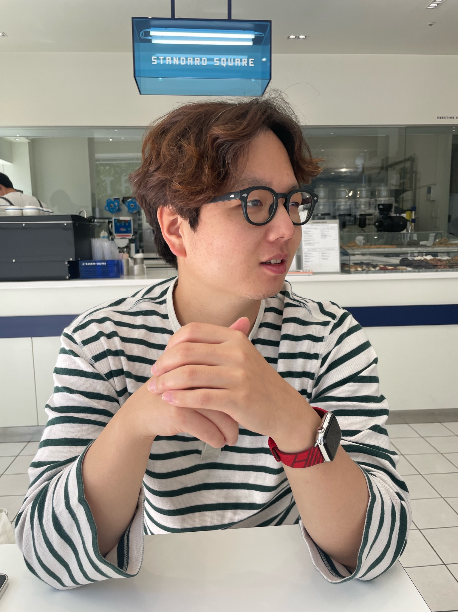

## 임준규
* [juniqlim@gmail.com](mailto:juniqlim@gmail.com)
* [juniq.im](https://juniq.im)

좋은 개발자는 고객에게 가치를 전달한다고 생각합니다.  
문제를 해결하기 위한 가장 단순한 것을 찾아, 실제로 필요한 것에 가까워지려 노력합니다.  
  
커머스, 핀테크, 헬스케어 등의 서비스를 만드는 회사에서 개발자로 일했습니다.  
오랫동안 주로 Java/Spring으로, 그리고 Python/Django로도 소프트웨어를 만들었습니다.  
AI Agent를 이용해 운영환경에 바로 배포 가능한 프로덕트를 빠르게 만드는 것을 좋아합니다.  
최종사용자는 물론, 같이 일하는 동료들도 만족시키는 것이 즐겁습니다.  
   
## 경력
* 프리랜서 (2026.04 ~ 현재)
  * 마이크로그리드 에너지 관리 시스템(MG EMS), 수요반응 관리 시스템(DRMS) 개발
  * 코드 전체를 AI Agent(Claude Code)로 작성, MG EMS 전체 할일 230개 중 114개를 처리 (개발자 5명, 모두 AI Agent 사용)
  * 사람의 개입을 최소화하면서도 문제없는 결과물이 나오는 지점을 찾아, 여러 에이전트를 병렬로 운용
  * 에이전트가 결과를 스스로 검증하도록 자동화 (백엔드: Newman API 테스트, 프론트엔드: Playwright MCP)
  * Java/Spring Boot 기반 MSA(MongoDB, MySQL, Redis, RabbitMQ)와 Nuxt/Vue로 백엔드·프론트엔드를 모두 개발
  * MG EMS
    * 회원·사이트·기기 관리 기능과 권한 검증 공통 모듈 개발
    * MQTT 기반 기기 제어 및 데이터 수집, 주기(15분~연간) 데이터 집계 API, 모니터링 차트 개발
  * DRMS
    * 기존 VPP(가상발전소) 시스템에 수요반응(DR) 기능 추가: 자원·고객·계약 관리, 입찰관리, 대시보드
    * Netty 기반 TCP 서버로 보조계량기 통신 및 전문 파싱 구현
* [메디쿼터스](https://mediquitous.com) (2023.07 ~ 2025.04)
  * 한국/일본 대상 패션&뷰티 커머스 플랫폼 회사, [nugu](https://www.nugu.jp)서비스를 개발/운영하는 개발팀에서 근무
  * python/django/svelte/sveltekit/react/next.js등 새로운 언어와 프레임웍을 학습하고 사용
  * 주문팀에서 주문/결제/배송의 개발/유지보수 진행
  * 한국PG사->일본PG사([GMO-PG](https://www.gmo-pg.com/en/))로 결제시스템 전환: 신용카드/간편결제/편의점/후불 관련API 연동
  * 전시파트의 기획전, 메인페이지 개발/유지보수 진행
  * 매우 짧은 주기로 메인 브랜치에 코드를 통합하는 것의 가치를 배우고, 실천하려 노력함 (30분 지향)
* [한패스](https://hanpass.com) (2020.01 ~ 2023.04)
  * 국내 외국인을 주 고객으로하는 핀테크 회사, 송금개발팀 백엔드 개발자로 근무
  * Spring Batch를 사용한 배치 개발
  * 대외연계(오픈뱅킹, 쿠콘, 유니온페이등)를 위한 서버, 모듈 개발
  * APM툴 도입, JPA 성능개선, Slow Query 개선
  * 배포 자동화, 테스트 코드 작성, 모듈화등 더 나은 생산성을 위해 여러 시도를 함
* [링크올](https://www.rocketpunch.com/companies/linkall) (2019.01 ~ 2020.01)
  * 병원자동화 시스템을 만드는 헬스케어 회사, 서버 개발자로 근무
  * 데이터교환 국제표준(FHIR)을 만족하는 [EMR](https://namu.wiki/w/EMR)(의료기록시스템) 초기설계
  * [나래의료재단](https://booking.naraemedic.com/medical/supplies)에서 사용할 검진프로그램 개발 
* 프리랜서 (2017.04 ~ 2018.12)
  * 11번가 전시파트 이벤트 개발 프로젝트, 서버개발자로 근무
  * SSF몰 UIUX 리뉴얼 전시파트 개발 프로젝트, 서버개발자로 근무
* [네트빌](https://www.netville.co.kr) (2007.12 ~ 2016.12)
  * 커뮤니티솔루션(게시판/블로그/카페/SNS등)을 가진 솔루션SI 회사, 서버개발자로 근무
  * 모델1 방식 프로젝트를 시작으로 대부분 Spring 프로젝트를 수행
  * [엔카닷컴](http://www.encar.com/index.do)에 4년정도 파견근무하며, 서비스 회사의 업무를 경험

## 일하는 방법
* 저에게 고객은 엔드유저만이 아니라 고용주, 매니저, 동료 모두 제 결과물을 만나는 고객입니다.
  * 어렵지만 이들 모두를 만족시키는 가치를 전달하기 위해 노력합니다.
* [뽀모도로 회고](https://note.juniq.im/notes/programming/pomodoro-retrospective.html)를 사용합니다.
  * 회고의 힘을 경험했고, 더 자주 할수록 더 많은 도움을 받았습니다. 
  * 최소 25분마다 불필요한 시간을 보내지 않았는지, 다른 관점에서 생각해봅니다.
* 단위테스트를 작성합니다.
  * [대체로 구현 전](https://note.juniq.im/notes/programming/why-tdd.html)에 작성합니다. 결과를 먼저 정의하면 불필요한 구현을 피할 수 있습니다. 
  * 문제의 한 부분을 먼저 정의하면, 나머지 부분의 모습도 더 빨리 구체화됩니다.
* 성과를 높이는 도구로 [이너게임](https://note.juniq.im/notes/programming/inner-game-coaching.html)을 활용합니다.
  * 나 자신에게도, 동료에게도 평가보다 관찰을, 지시보다 질문을 먼저 합니다. 
  * "잘해야 한다"고 채근하는 것이 오히려 성과를 방해할 때가 많았습니다.
* [에이전틱 코딩](https://note.juniq.im/notes/programming/ai-agent/better-agentic-coding.html)을 적극적으로 사용합니다.
  * 에이전트가 직접 검증할 수 있도록 코칭해서, 진행속도와 품질을 높이려 합니다.
  * 동작하는 작은 코드를 테스트부터 만들고, 매우 작은 주기로 회고하는 방식이 에이전틱 코딩과 잘 맞는다고 생각합니다. 

## 교육
* NEXTSTEP - [TDD, 클린 코드 with Java](https://note.juniq.im/notes/programming/2023-01-08-nextstep-tdd-review.html) (2021.03 ~ 2021.05) 
* 강남대학교 - 컴퓨터공학 전공 (2001.03 ~ 2008.02)
